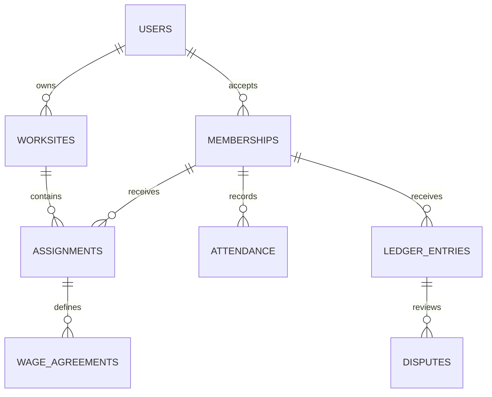

# Day 2: Database design

PostgreSQL design. Migrations 001–004 implement users, worksites, accepted memberships, assignments and wage agreements and have passing database checks as of 25 November 2026. Attendance, ledger, disputes and audit tables below remain proposed. See [verification evidence](VERIFICATION_2026-11-25.md).

| Table | Key fields and constraints |
|---|---|
| users | UUID PK, unique normalized email, password_hash, role worker/contractor |
| memberships | UUID PK, contractor_id and worker_id user FKs, unique pair, invited/accepted status |
| worksites | UUID PK, contractor_id FK, name, location, active |
| assignments | UUID PK, contractor_id, composite membership/worksite ownership FKs, accepted-membership guard, start/end dates |
| wage_agreements | UUID PK, assignment_id FK, increasing effective date, positive daily_rate_paise bigint, immutable terms, acknowledged_at/by |
| attendance | UUID PK, membership_id FK, assignment_id FK, work_date, half_day_units 0/1/2, rate snapshot, posted status |
| ledger_entries | UUID PK, membership_id FK, attendance_id FK optional, signed amount_paise bigint, kind, effective date, reversal_of unique FK |
| disputes | UUID PK, ledger_entry_id FK, reason, response, proposed correction, open/responded/resolved status |
| audit_events | UUID PK, actor FK, entity type/id, event, timestamp, before/after JSONB |

All timestamps timestamptz. Work dates use Asia/Kolkata. A unique active attendance constraint on membership/date prevents duplicate work across sites; corrections reverse and supersede original entries. Use composite ownership constraints to prevent assignments crossing contractor boundaries. Effective wage periods must not overlap. Posted records are immutable; restrict deletion of referenced financial records. These constraints must be implemented and tested in migrations before marking setup complete.

Future attendance/ledger constraints in the preceding paragraph are design requirements, not implemented database guarantees. Assignment/wage agreement constraints are described in [ASSIGNMENTS_API.md](ASSIGNMENTS_API.md). Their implicit periods end at the next proposal's effective date; a pending proposal is not an approved rate for posting.

## Ledger migration — 29 November 2026

Migration 005 implements immutable ledger rows for attendance and financial postings. Attendance rows retain assignment, accepted wage agreement, units and applied rate. A separate worker-day slot prevents conflicting current attendance across worksites. A correction releases or replaces the slot while keeping the original posting, reversal and replacement in the ledger. Participant-specific review and receipt events are separate. Append-only ledger events carry the actor, reason and time for dispute responses and resolutions. [Ledger API and integrity rules](LEDGER_API.md)
