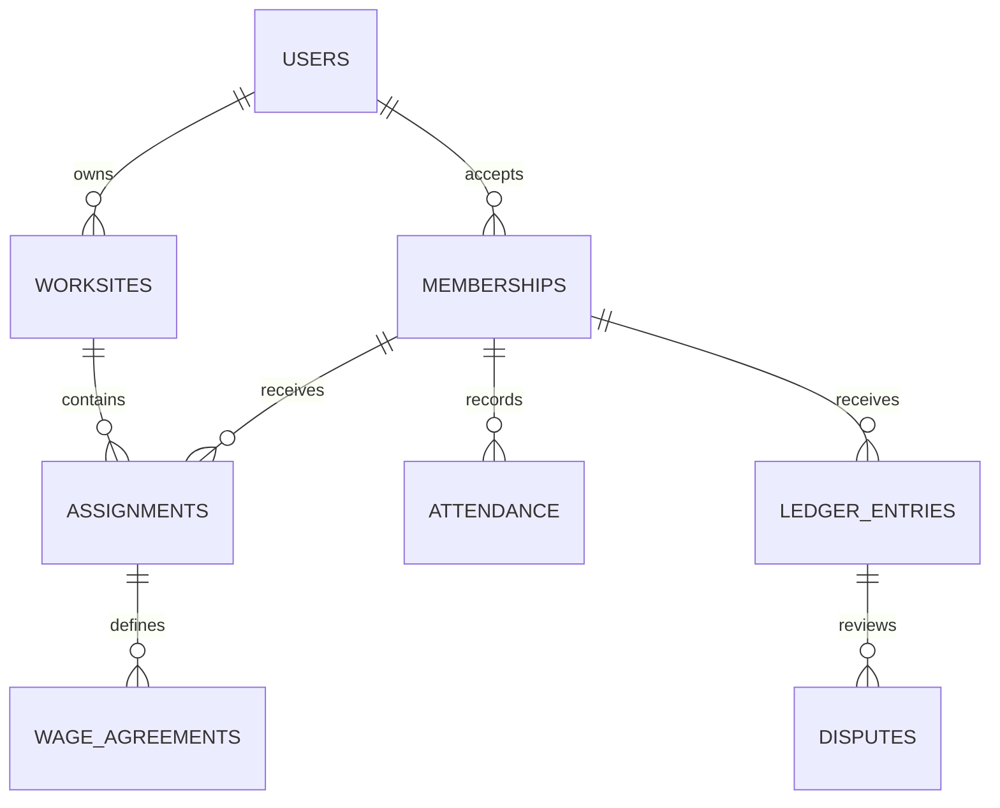

# Day 2: Database design

Proposed PostgreSQL design; migration and database validation pending.

| Table | Key fields and constraints |
|---|---|
| users | UUID PK, unique normalized email, password_hash, role worker/contractor |
| memberships | UUID PK, contractor_id and worker_id user FKs, unique pair, invited/accepted status |
| worksites | UUID PK, contractor_id FK, name, location, active |
| assignments | UUID PK, membership_id FK, worksite_id FK, start/end dates |
| wage_agreements | UUID PK, assignment_id FK, effective date, positive daily_rate_paise bigint, acknowledged_at |
| attendance | UUID PK, membership_id FK, assignment_id FK, work_date, half_day_units 0/1/2, rate snapshot, posted status |
| ledger_entries | UUID PK, membership_id FK, attendance_id FK optional, signed amount_paise bigint, kind, effective date, reversal_of unique FK |
| disputes | UUID PK, ledger_entry_id FK, reason, response, proposed correction, open/responded/resolved status |
| audit_events | UUID PK, actor FK, entity type/id, event, timestamp, before/after JSONB |

All timestamps timestamptz. Work dates use Asia/Kolkata. A unique active attendance constraint on membership/date prevents duplicate work across sites; corrections reverse and supersede original entries. Use composite ownership constraints to prevent assignments crossing contractor boundaries. Effective wage periods must not overlap. Posted records are immutable; restrict deletion of referenced financial records. These constraints must be implemented and tested in migrations before marking setup complete.
