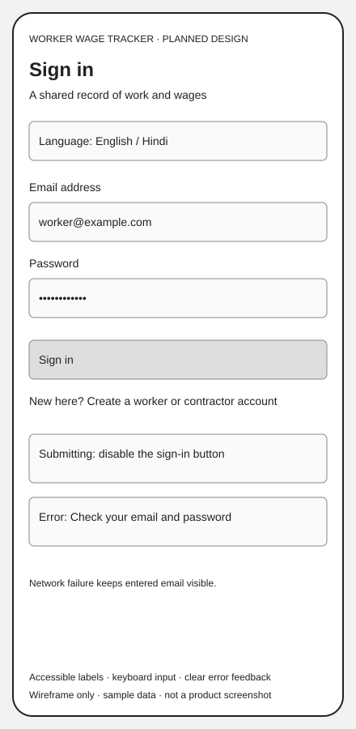
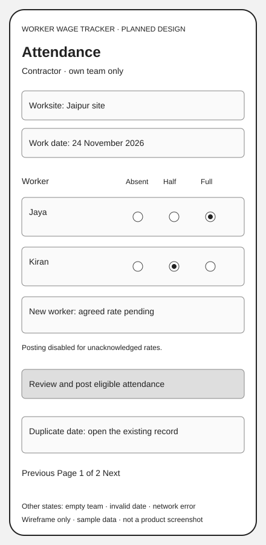
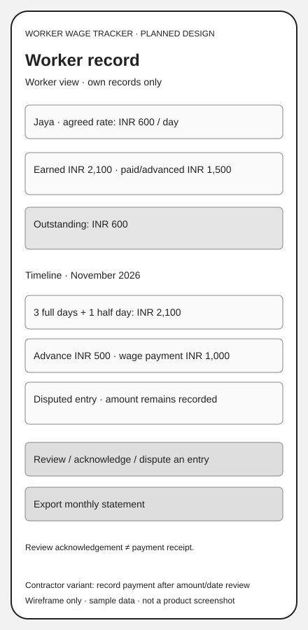
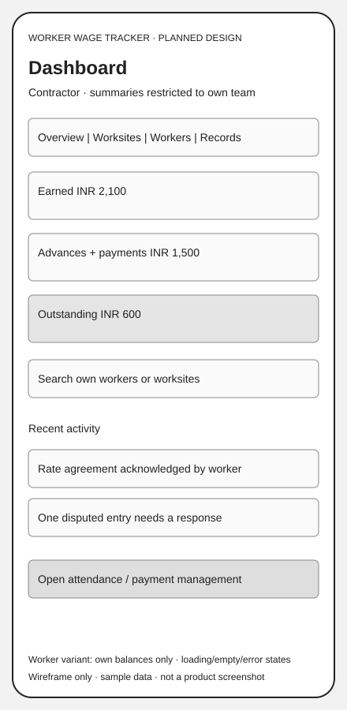

# Day 2: Four screen wireframes

Completed design evidence on 25 November 2026. Four SVG assets were rendered and visually reviewed. They depict planned screens and sample data, including features still unimplemented; they are not application screenshots.

| Screen | Top | Main area | Actions and states |
|---|---|---|---|
| Login | Product name; English/Hindi switch | Email and password fields; signup link | Sign in; submitting, invalid credentials, network failure |
| Attendance list | Worksite selector; date filter | Worker rows with full/half/absent selection; pagination | Save draft, post attendance; empty team, duplicate date, validation errors |
| Worker detail | Worker name and agreed rate | Attendance timeline; earnings, advances, payments; disputed entries visibly flagged | Record payment, export month, acknowledge or dispute own entry |
| Dashboard | Role-aware navigation | Earnings, paid amount, outstanding balance; recent activity | Contractor sees own team; worker sees own records; loading/empty/error states |

Mobile layout stacks summaries above lists. Financial confirmations show amount and date before submission. Workers never see another worker's balances. Draft changes and posted corrections have separate actions.

## Login

## Attendance list

## Worker detail

## Dashboard

